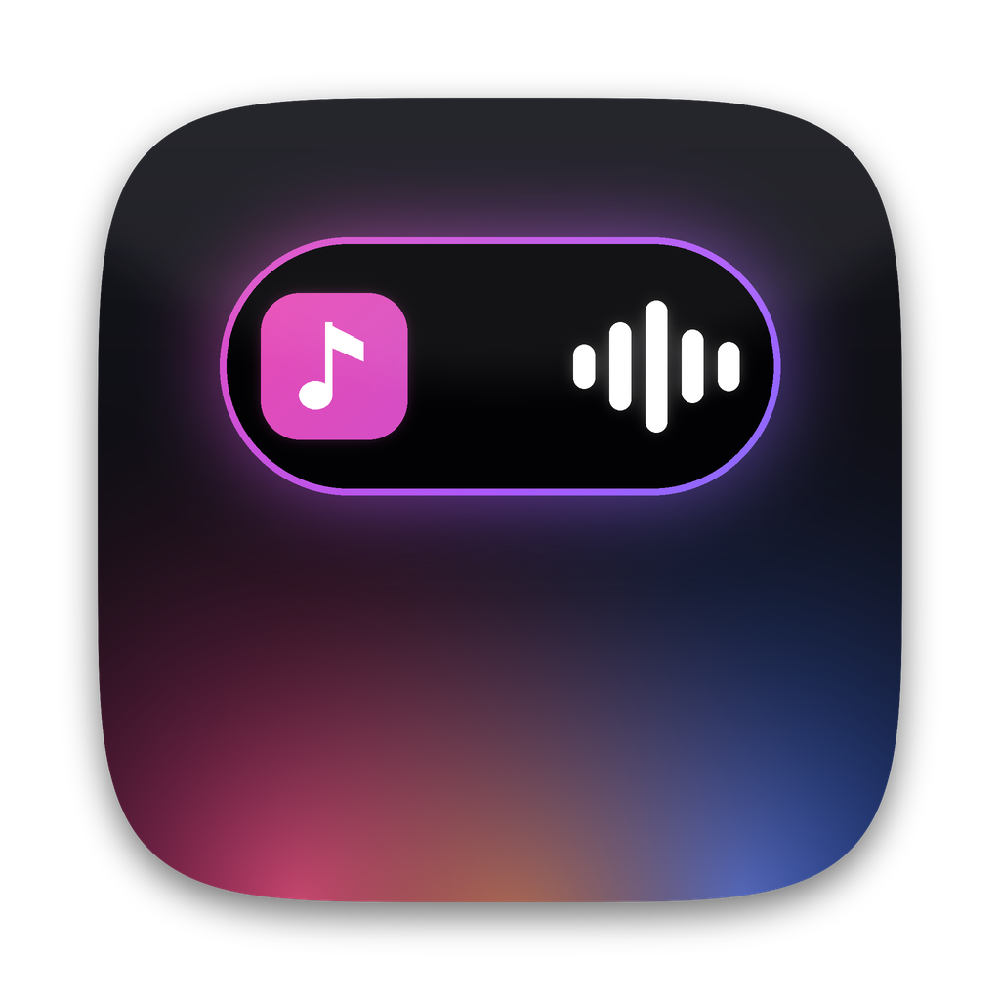

<p align="center"></p>

# Notchly

A dynamic island for your MacBook notch — music, calendar, reminders, clipboard, file tray + AirDrop, timers, system stats, camera mirror and an app launcher, in one animated, themeable panel.

Free, open source, no account, **no tracking**. Inspired by apps like Dynamic Ledge and Seam; not affiliated with them.

## Is it safe?
- 🔒 **Local only** – no server, no analytics, no telemetry. See [PRIVACY.md](PRIVACY.md).
- 🌐 **Network is optional** – only lyrics (lrclib.net) and Spotify artwork, and you can turn it off in Settings → Privacy.
- 🔎 **Auditable** – ~3k lines of Swift. `grep -rn URLSession Sources/` shows every network call.
- 🧱 **Build it yourself** – nothing precompiled to trust. See [SECURITY.md](SECURITY.md) for the honest limitations (ad-hoc signed, not sandboxed, uses a private Apple API for Now Playing).
- 🛑 **Permissions are on demand** – Calendar, Reminders, Camera (Mirror tab only) and Spotify/Music control, each revocable in System Settings.

## Features
- Hover (or click / ⌥Space) to open; spring animations; two-finger swipe between tabs
- **Now Playing from any app** (Spotify, Apple Music, YouTube in a browser, VLC…) with artwork, progress, controls and synced lyrics; choose which app groups to show
- Live activities: music ears, timer, keep-awake, charger, low battery, volume, calendar start, downloads
- Tabs (drag to reorder, show/hide): Home, Tray + AirDrop, Clipboard, Notes, Calendar, Reminders, Timer/Stopwatch/Focus, System stats, Camera mirror, App launcher
- 11 themes + glass (Liquid Glass on macOS 26), card styles, size / corner / ear sliders
- **Battery saver** and a **Pause Notchly** switch to stop all background work

## Install
Requires macOS 14+ and the Xcode Command Line Tools (`xcode-select --install`).

```bash
git clone https://github.com/<your-username>/Notchly.git
cd Notchly
chmod +x build.sh && ./build.sh
```
The app is created in `build/Notchly.app`. If macOS blocks it: right-click → Open.

## Battery & background use
Settings → Battery: *Pause completely*, *Battery saver*, *auto-enable when unplugged*. Menu bar icon → *Pause Notchly* also works.

## Contributing
Issues and PRs welcome. Please keep the no-telemetry promise.

## License
MIT — see [LICENSE](LICENSE).
