<p align="center"></p>

<h1 align="center">Notchly</h1>

<p align="center"><b>A control centre in your MacBook's notch.</b><br>
Music, calendar, files, timers and quick actions, one hover away. No app switching.</p>

<p align="center">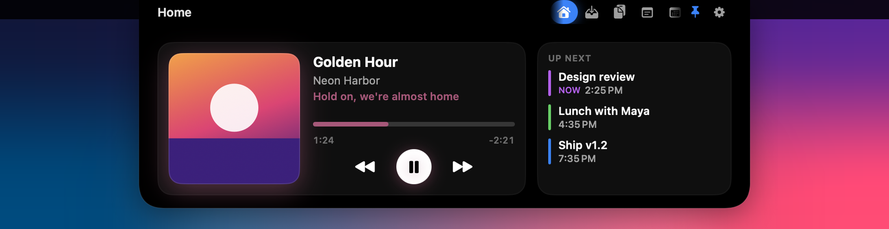</p>

Free, open source, no account, **no tracking**. Inspired by apps like Dynamic Ledge and Seam; not affiliated with them.

> Screenshots are captured from the running app with built-in sample data (so none of the author's own calendar, clipboard or music appears). The hero image is the real Home tab placed on a generated wallpaper. `./scripts/screenshots.sh` reproduces all of them.

## The problem it solves
Your notch is the most valuable, most wasted pixel real estate on a MacBook. Notchly turns it into a glanceable, always-available control centre, so skipping a song, checking your next meeting, parking a file, starting a timer or toggling dark mode takes one hover instead of an app switch.

## What you get
| | |
|---|---|
| **Now Playing from any app** | Spotify, Apple Music, YouTube in a browser, VLC… artwork, scrubber, controls and synced lyrics. Music "ears" when the notch is closed. |
| **Tray / Shelf** | Drop files on the notch, select several, drag them out anywhere together, or AirDrop them. |
| **Clipboard history** | Search, pin snippets you reuse, one click to copy. Password-manager items are skipped. |
| **Notes** | Multiple quick notes that save as you type. |
| **Calendar & Reminders** | A 7-day strip with busy dots, a "now" marker, event alerts, tick off to-dos, add new ones. |
| **Timer, Stopwatch, Focus** | Focus/break cycles with a live countdown beside the notch. |
| **Controls** | Do Not Disturb, Dark Mode, Keep Awake, Mute, Screenshot, Screen Saver, Sleep Display, Battery Saver. Plus **your own shortcuts**: apps, websites, Shortcuts-app automations or shell commands. |
| **System** | CPU, memory, disk and battery with a live CPU sparkline. |
| **Weather** *(opt-in)* | Current conditions and the next hours. Off by default. |
| **Camera mirror, App launcher** | A quick mirror before a call; your favourite apps one click away. |
| **Live activities** | Charger plugged/unplugged, low battery, volume, new song, calendar start, finished download. |
| **Make it yours** | 12 themes (including Glass, which is Liquid Glass on macOS 26), accent colour, card styles, size and corner sliders. **Reorder tabs by dragging, hide the ones you don't use.** The panel adapts cleanly from small (440×130) to large (900×280). |

<table>
<tr>
<td>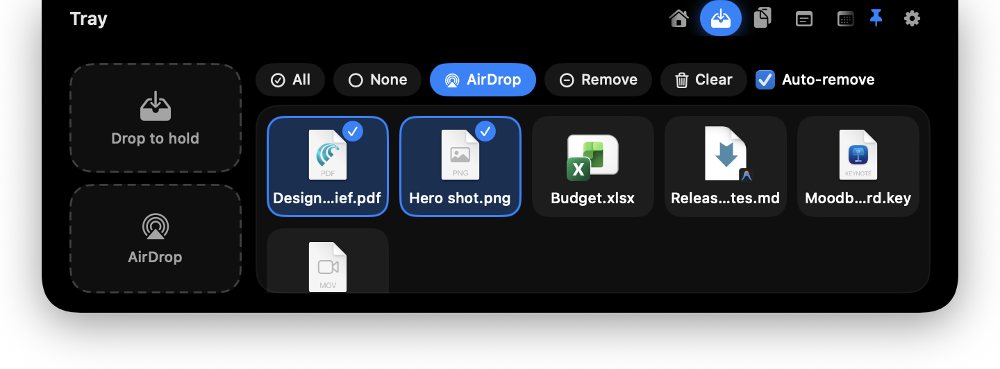</td>
<td>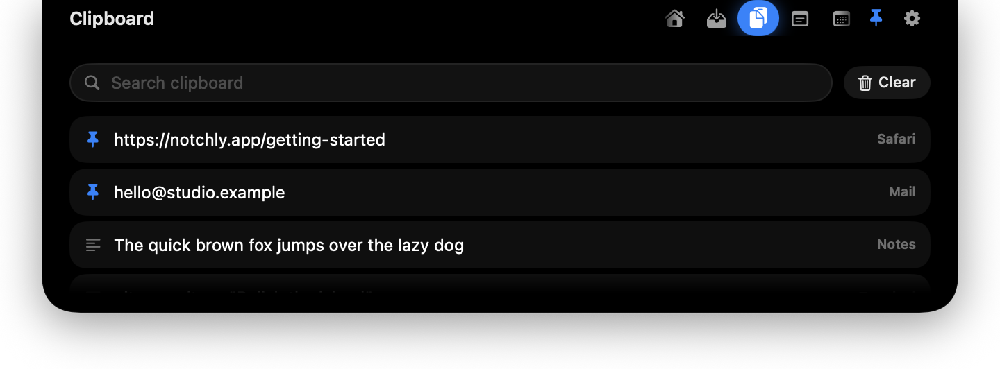</td>
</tr>
<tr>
<td>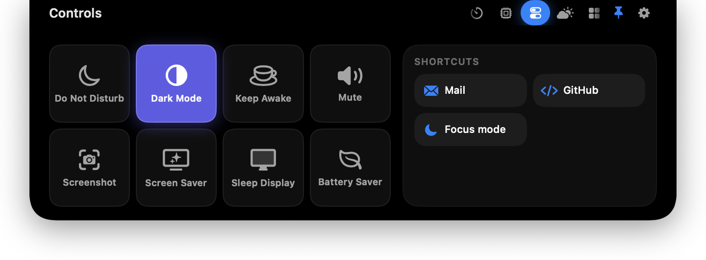</td>
<td>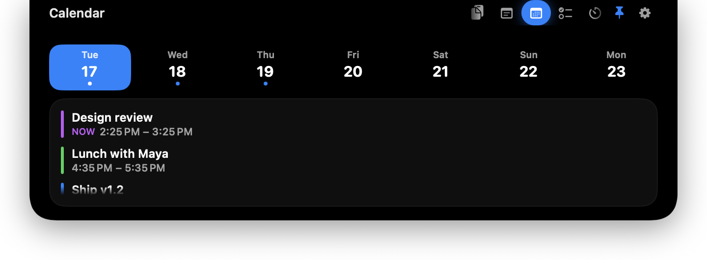</td>
</tr>
<tr>
<td>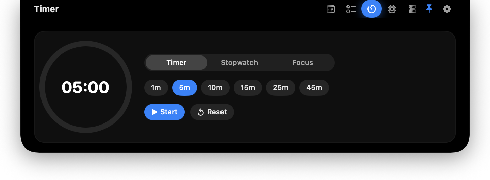</td>
<td>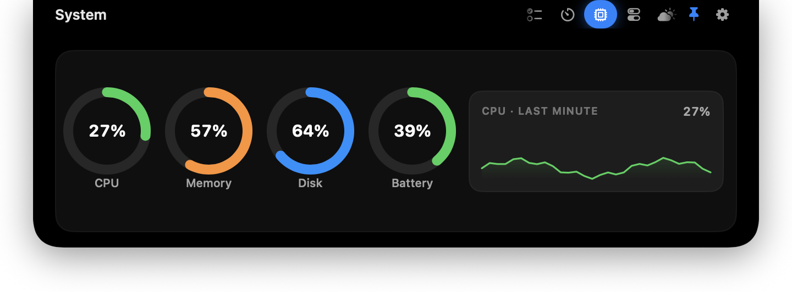</td>
</tr>
<tr>
<td>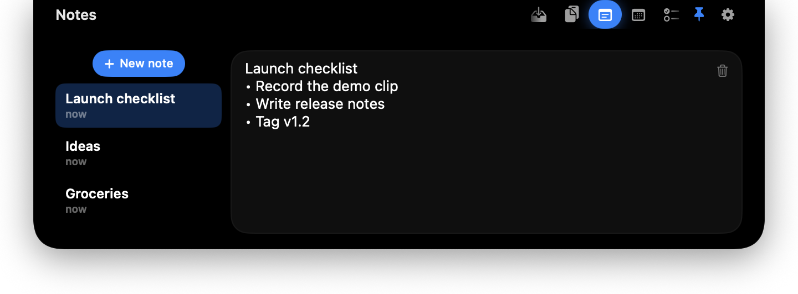</td>
<td>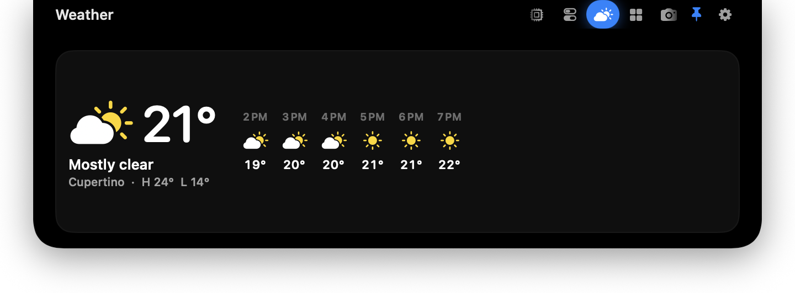</td>
</tr>
<tr>
<td align="center">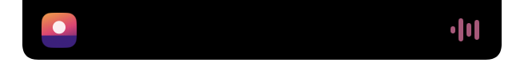<br><sub>Closed: music ears</sub></td>
<td align="center">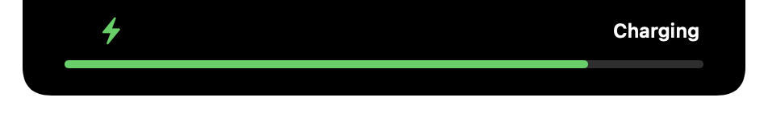<br><sub>Live activity alert</sub></td>
</tr>
</table>

<table>
<tr>
<td>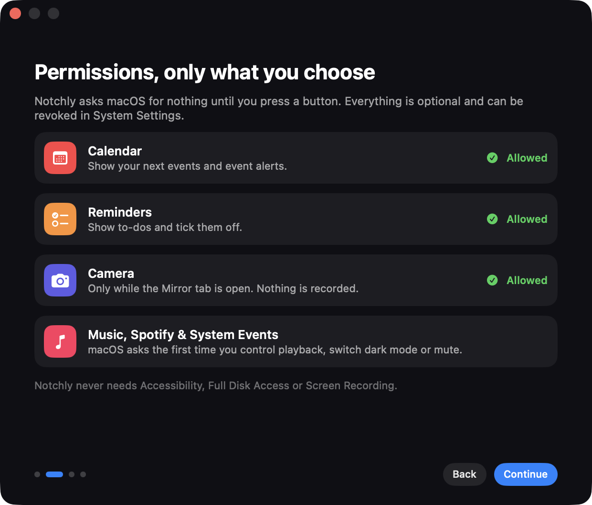</td>
<td>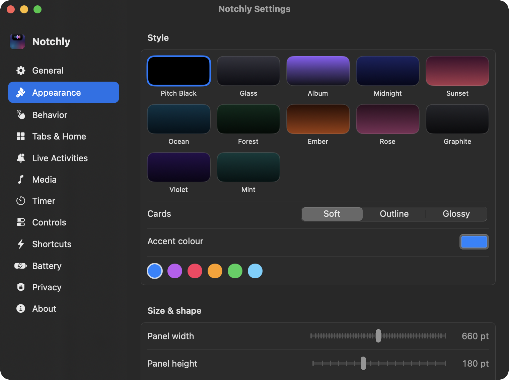</td>
</tr>
<tr>
<td align="center"><sub>First run: permissions explained, all optional</sub></td>
<td align="center"><sub>Settings: themes, sizes, tabs, shortcuts, privacy</sub></td>
</tr>
</table>

## Using it
| Do this | To |
|---|---|
| Hover the notch (or click it, your choice in Settings) | Open |
| **⌥ Space** | Open / close from anywhere (stays open until you move the pointer in, or press Esc) |
| **Esc**, or move the pointer away | Close |
| Drag a file toward the notch | Open the Tray with it ready to drop |
| Two-finger swipe left / right | Next / previous tab |
| Drag tab icons in the header | Reorder tabs |
| 📌 in the header | Keep it open |
| Right-click the island | Open, Keep Awake, Settings, Quit |

## Install
Requires **macOS 14 or later**. Works on Macs without a notch too (it becomes a small pill at the top).

### Option 1: download the zip
Grab `Notchly-<version>.zip` from the Releases page, unzip, and drag **Notchly.app** to Applications. The app is *ad-hoc signed, not notarized* (there is no paid Apple Developer account behind it), so the first time: **right-click → Open → Open**. If macOS still refuses:
```bash
xattr -dr com.apple.quarantine /Applications/Notchly.app
```

### Option 2: build it yourself (nothing precompiled to trust)
Needs the Xcode Command Line Tools only (`xcode-select --install`), not full Xcode.
```bash
git clone <this repo's URL>
cd Notchly
./build.sh            # builds build/Notchly.app and launches it
./scripts/package.sh  # optional: also makes dist/Notchly-<version>.zip to share
```

On first launch a short tour explains each permission. Everything is optional.

## Privacy & safety
- 🔒 **Local only.** No server, no analytics, no crash reporting, no telemetry, no account. See [PRIVACY.md](PRIVACY.md).
- 🌐 **Network is optional and listed in full:**
  | Feature | Contacts | Sends | Default |
  |---|---|---|---|
  | Lyrics | `lrclib.net` | track title / artist / album | on, switchable |
  | Artwork (Spotify) | the image URL Spotify provides | a normal image request | on, switchable |
  | Weather | `open-meteo.com` | the city you typed, then its coordinates | **off** |

  One switch (Settings → Privacy → *Allow internet access*) turns all of it off. `grep -rn URLSession Sources/` shows every call.
- 🧱 **Auditable.** About 4.5k lines of Swift. Build it yourself.
- 🛑 **Permissions on demand.** Calendar, Reminders and Camera (Mirror only) are asked for *only* when you press Allow. Notchly never needs Accessibility, Full Disk Access or Screen Recording.
- 📋 **Clipboard history is in memory** and gone when you quit. Only snippets *you pin* are saved on your Mac.
- ⚠️ **Honest limits:** ad-hoc signed and not sandboxed; Now Playing uses a private Apple framework (MediaRemote) that Apple may change; custom *shell command* shortcuts run with your permissions, so only add commands you understand. Details in [SECURITY.md](SECURITY.md).

## Battery & performance
Notchly is event-driven: **no polling timer while the notch is closed.** Measured on a MacBook with `top`: about **0.0–0.1 % CPU and well under one wakeup per second** when idle (it was ~1.1 % before the rewrite).
- **Battery saver** (Settings → Battery, or the Controls tab): slower clipboard checks, calmer animations, no lyric downloads; can switch on automatically when unplugged.
- **Pause Notchly** (menu bar icon): stops everything, hides the notch.
- It also pauses itself while the screen is asleep.

## Development
```bash
./build.sh                       # build + launch
./scripts/screenshots.sh         # re-record docs/ from the running app (sample data, factory settings)
swift scripts/make-icon.swift    # regenerate the app icon (png + icns)
./scripts/package.sh             # zip for sharing
```
Launch arguments (never saved): `-demoMode YES` sample data, `-factoryDefaults YES` ignore saved settings, `-debugHooks YES` lets scripts open tabs via `notifyutil -p notchly.debug.open.<tab>`. Code map and rules for contributors are in [CLAUDE.md](CLAUDE.md).

## Uninstall
Quit from the menu bar icon, delete `Notchly.app`, and optionally remove its settings: `defaults delete com.sanketh.Notchly`.

## Contributing
Issues and PRs welcome. Please keep the no-telemetry promise.

## License
MIT. See [LICENSE](LICENSE).
